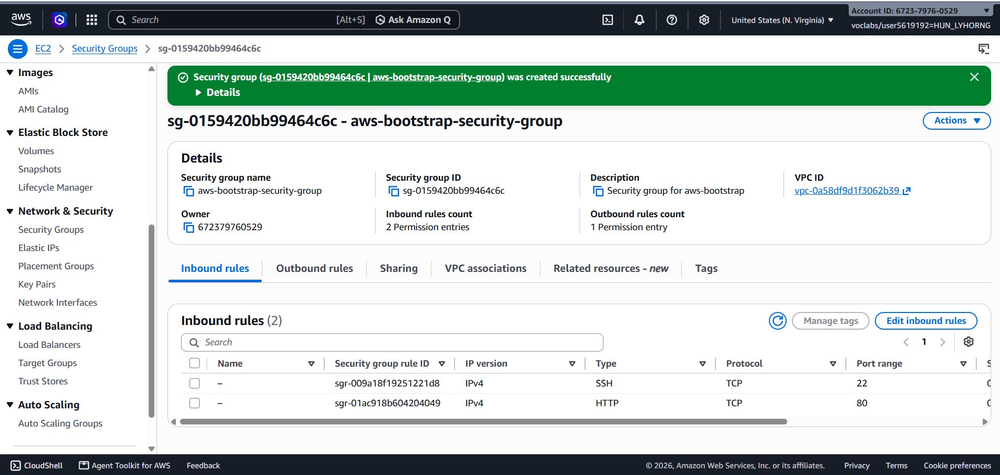
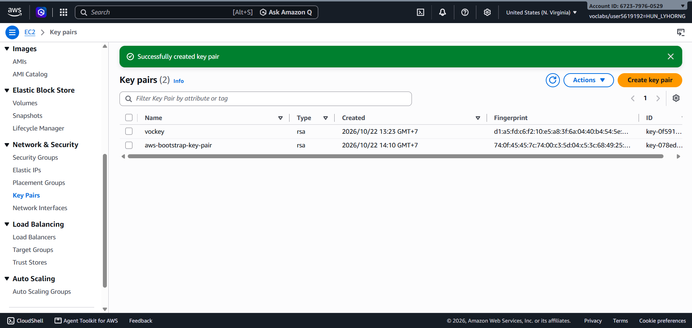
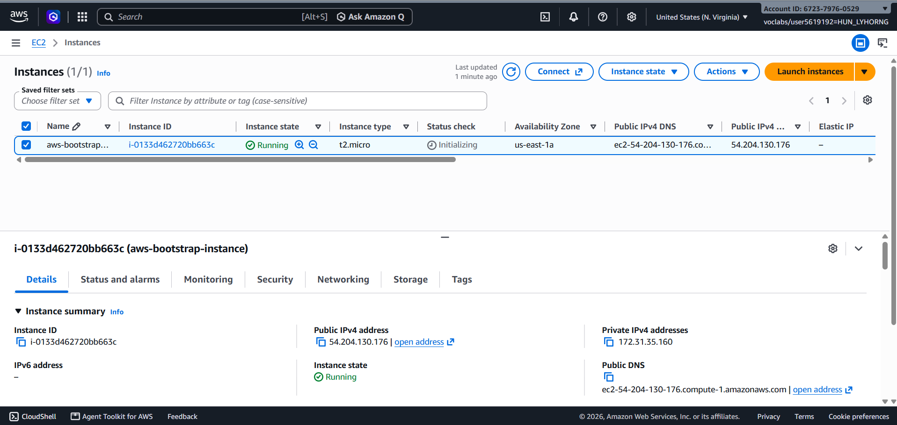
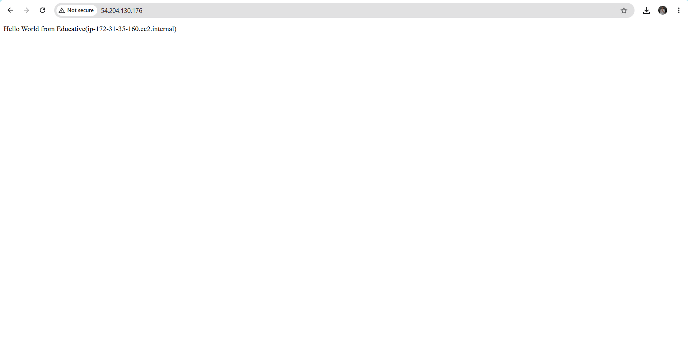
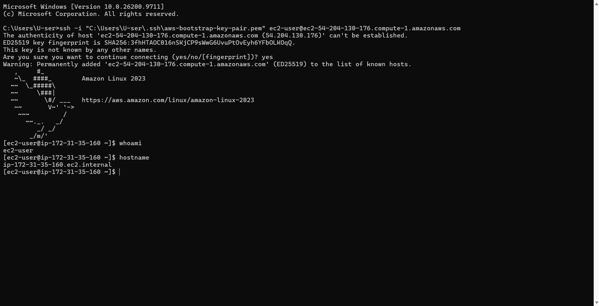
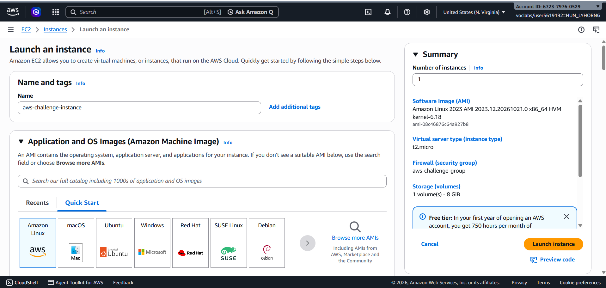
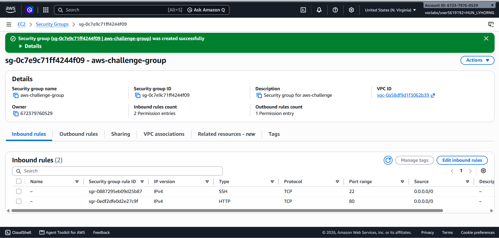
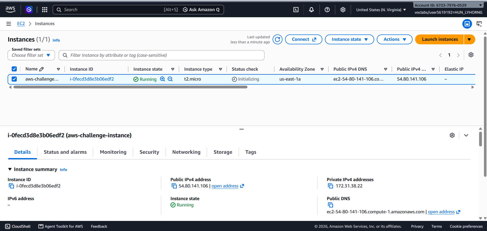
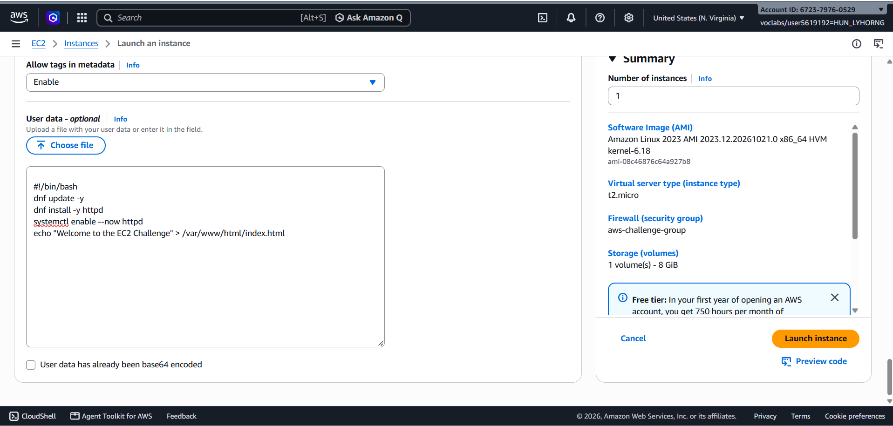
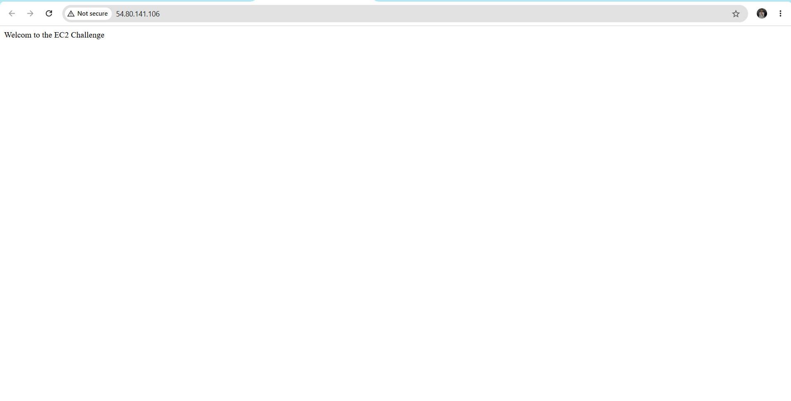

# Cloud Lab 1 Submission — Amazon EC2

- **Student name: Hun Lyhorng**
- **Student ID: e20220188**
- **Learner Lab user name: HUN LYHORNG**
- **Date completed: 22/10/2026**

---

## Part 1.1 — An Amazon EC2 Walkthrough

### Security group



### Key pair



### Instance details



### Browser test



### SSH connection



Did you connect with your own SSH client or with EC2 Instance Connect?

---

## Part 1.2 — EC2 Web Solution (Challenge)

### Launch configuration



### Security group



### Running instance



### Commands on the instance



Paste the commands you ran to install the web server and create `index.html`:

```bash
#!/bin/bash
dnf update -y
dnf install -y httpd
systemctl enable --now httpd
echo "Welcome to the EC2 Challenge" > /var/www/html/index.html
```

### Browser test



---

## Questions

1. Your security group has an SSH rule and an HTTP rule. What does each one let you do? What would stop working if you deleted the HTTP rule?
2. In Part 1.1 you never logged in to install the web server. What installed it, and when did it run?
3. Why does the web page open with `http://` but not with `https://`?
4. Part 1.2 asked for a 10 GiB root volume. Where in the launch settings did you set it, and how can you check the size on the running instance?

---

## Answer

1. The SSH rule allows remote access to the EC2 instance through port 22, so I can connect to the Linux terminal and manage the server. The HTTP rule allows users to access the web page through port 80 using a web browser. If I delete the HTTP rule, users cannot access the web page through HTTP, even if the Apache web server is running.

2. The User Data script installed the web server automatically. It ran when the EC2 instance started for the first time. The script updated the system, installed Apache using `yum install -y httpd.x86_64`, started the Apache service, enabled it at boot, and created the `index.html` file. Therefore, I did not need to log in and install the web server manually.

3. The web server was configured to serve the page over HTTP on port 80. HTTPS requires TLS/SSL configuration and a certificate, which were not configured in this lab. Therefore, the page works with `http://` but does not work with `https://`.

4. I set the root volume size to 10 GiB in the **Configure storage** section when launching the EC2 instance. To check the size, I can select the running instance in the EC2 console, open the **Storage** tab, and inspect the root EBS volume. I can also select the volume under **Elastic Block Store → Volumes** and check its size. It should show 10 GiB.


## Problems and how I solved them (optional)

## AI note (optional)

One suggestion an AI tool gave you and how you checked it.

## Clean up

- [ ] Part 1.1: instance terminated, key pair and security group deleted.
- [ ] Part 1.2: instance terminated, security group (and key pair, if any) deleted.