# Cloud Lab 2 Submission — Load Balancer and Auto Scaling

- **Student name:** Hun Lyhorng
- **Student ID:** e20220188
- **Learner Lab user name:** HUN_LYHORNG
- **Date completed:** 05/11/2026

---

## Security groups

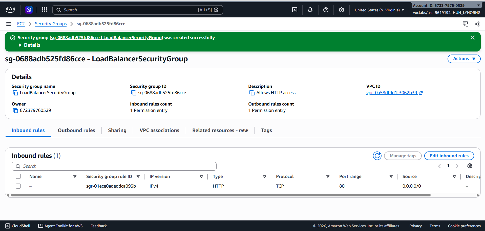

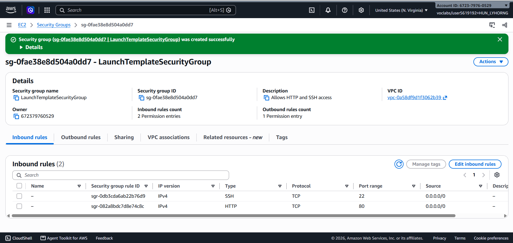

## Target group

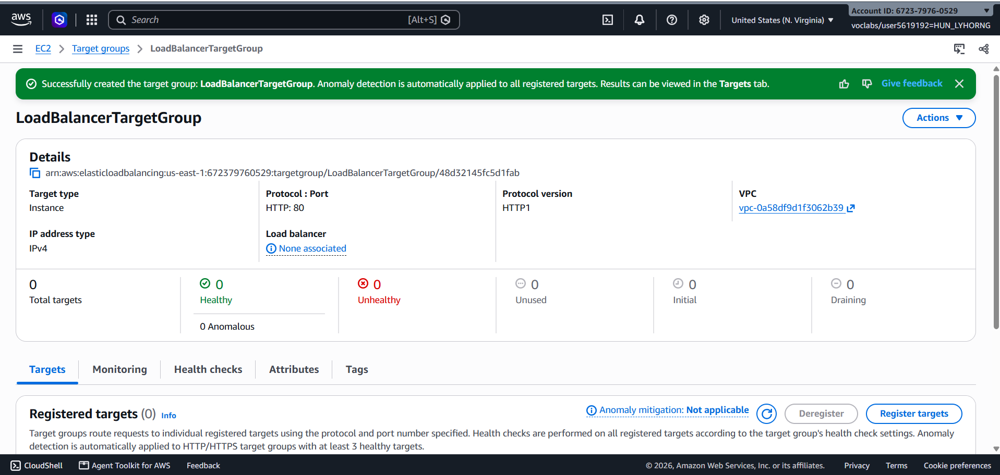

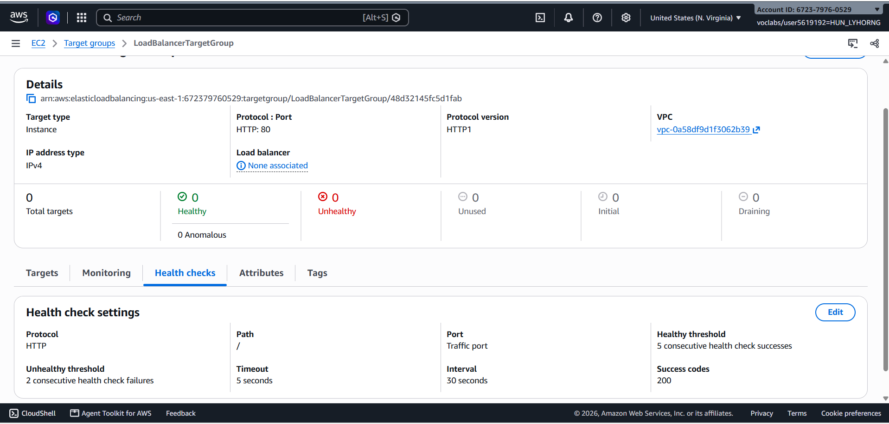

## Application Load Balancer

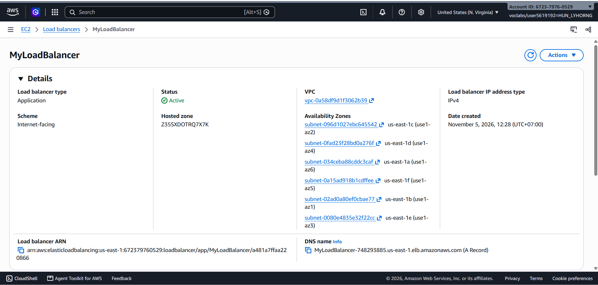

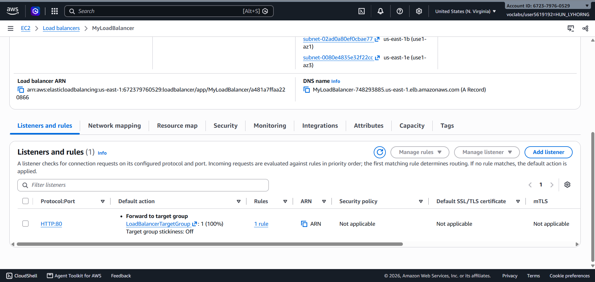

## Launch template

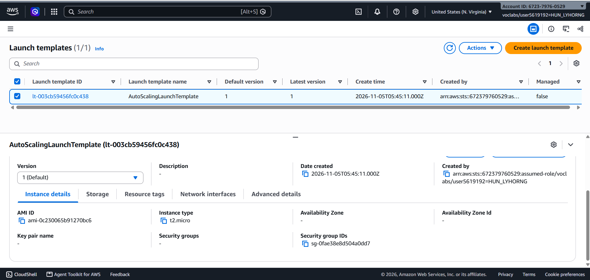

## Auto Scaling group

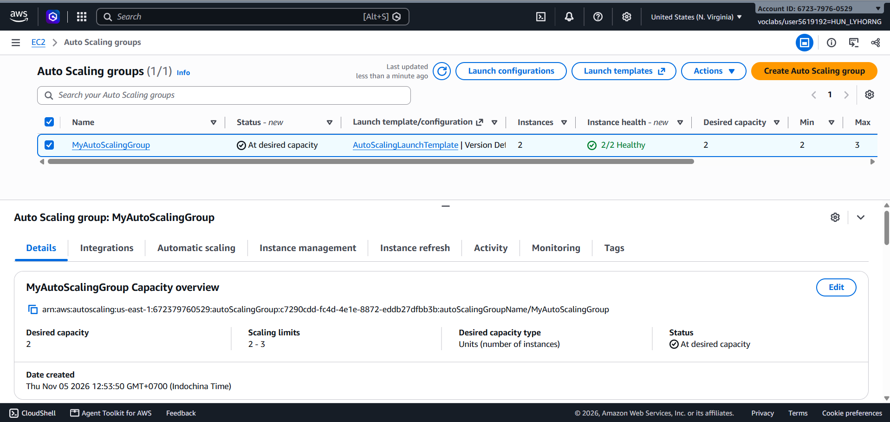

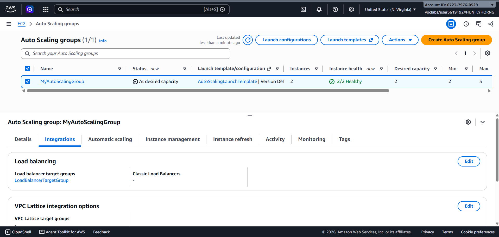

## Load balancing test

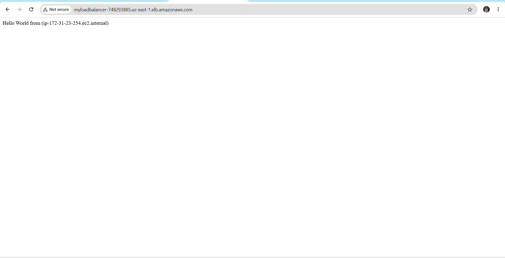

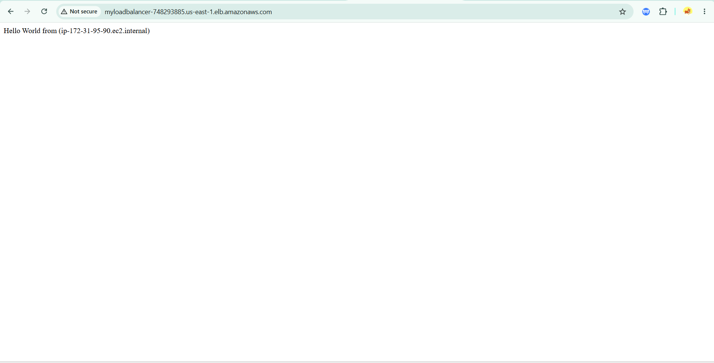

## Simulated application failure

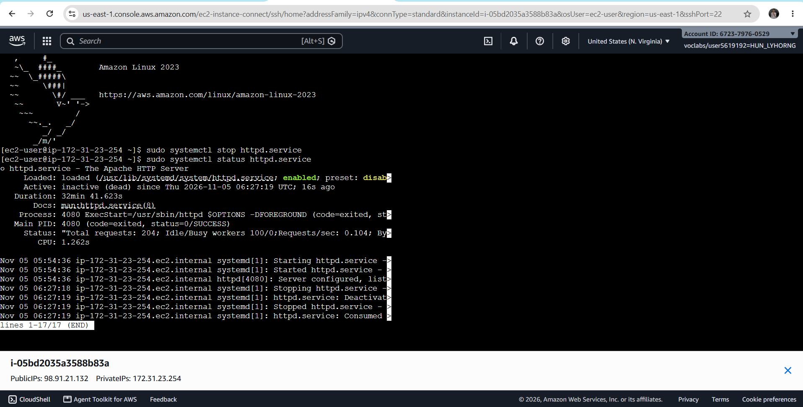

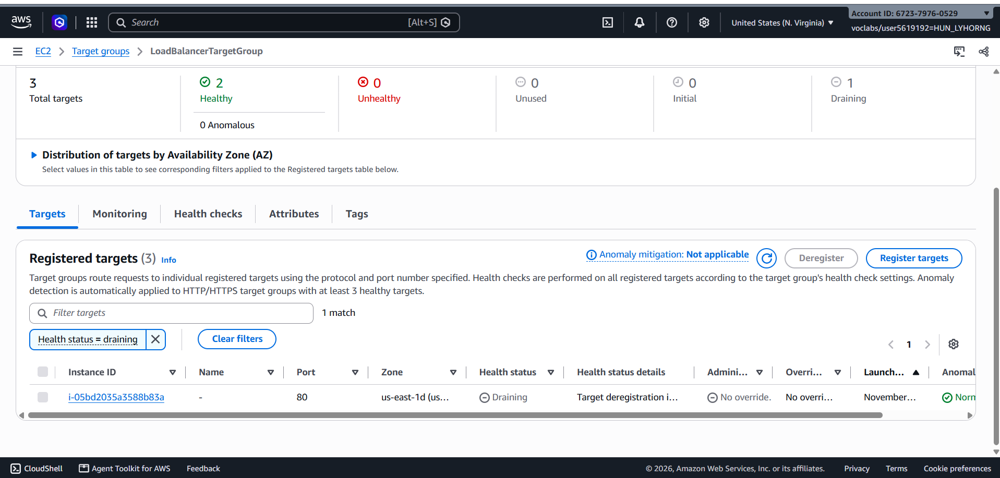

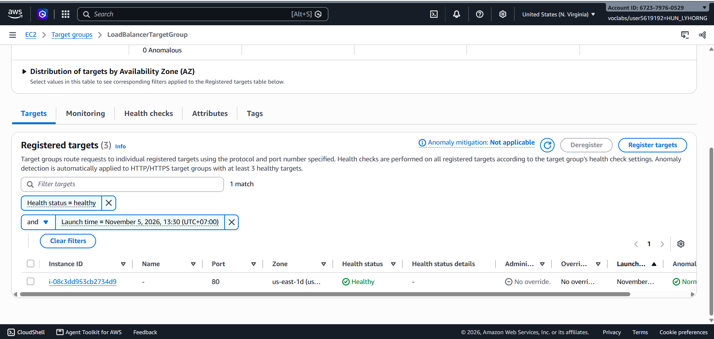

---

## Questions and Answers

1. Why does the page show a different host name when you refresh it?

    Because the load balancer distributes requests across different healthy EC2 instances, each with its own host name.

1. Why was the instance marked unhealthy after stopping httpd?

    The health check tests whether the web server responds to HTTP requests on port 80. After stopping httpd, the server could no longer respond, so the target became unhealthy.

2. Who replaced the failed instance?

    The **Auto Scaling** group replaced it.
    - Load Balancer: Distributes incoming traffic.
    - Target Group: Checks instance health.
    - Auto Scaling Group: Replaces unhealthy instances.

3. How many instances normally run? When could there be 3?

    Normally, 2 instances run because the desired capacity is 2. There could temporarily be 3 during instance replacement or when scaling out, without exceeding the maximum capacity.

4. How can instances accept HTTP only from the load balancer?

    Change the HTTP inbound rule in LaunchTemplateSecurityGroup from Anywhere-IPv4 to the security group ID of LoadBalancerSecurityGroup. This allows HTTP traffic only from the load balancer.