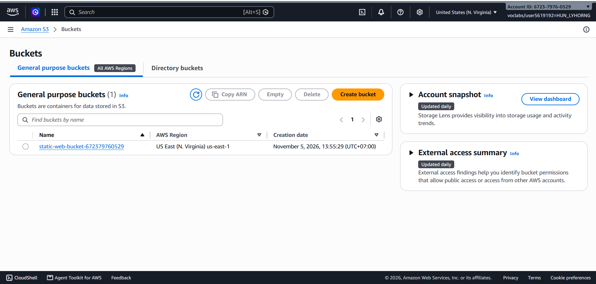
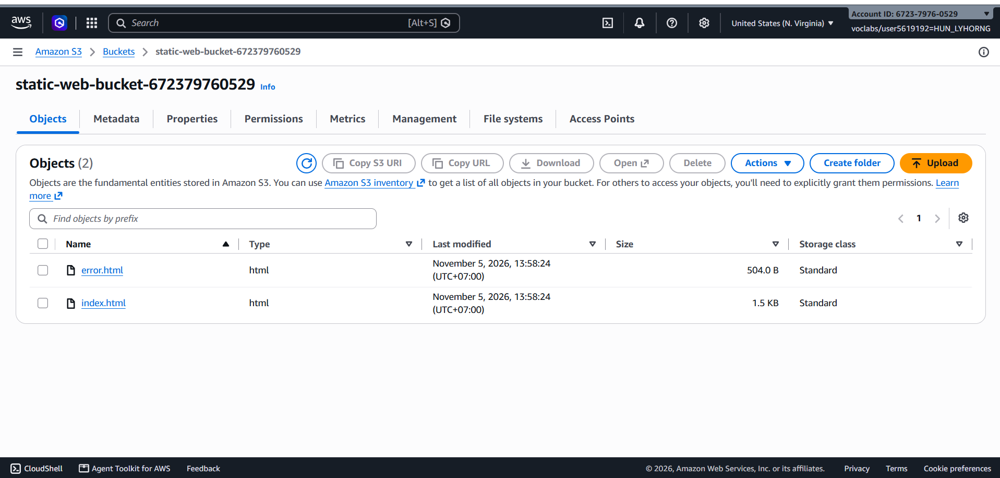
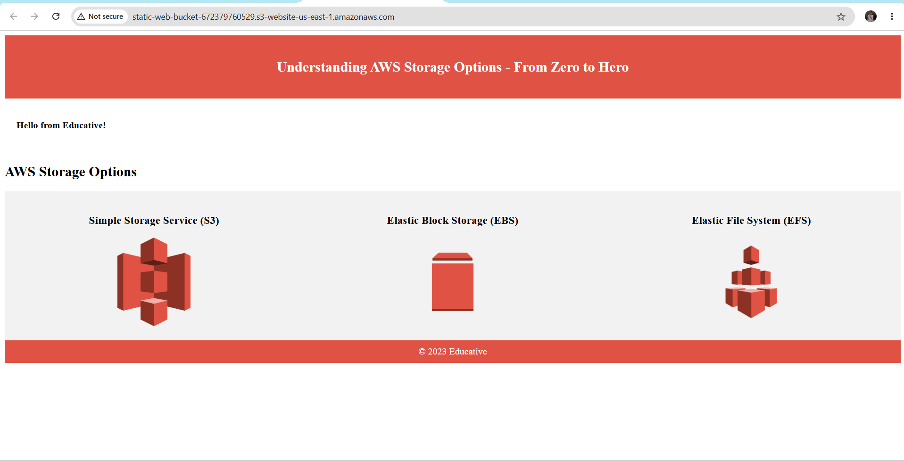
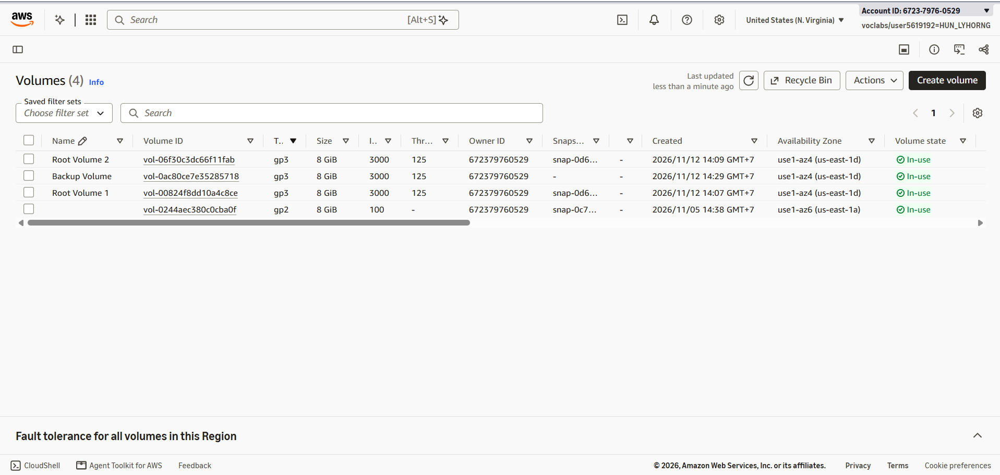
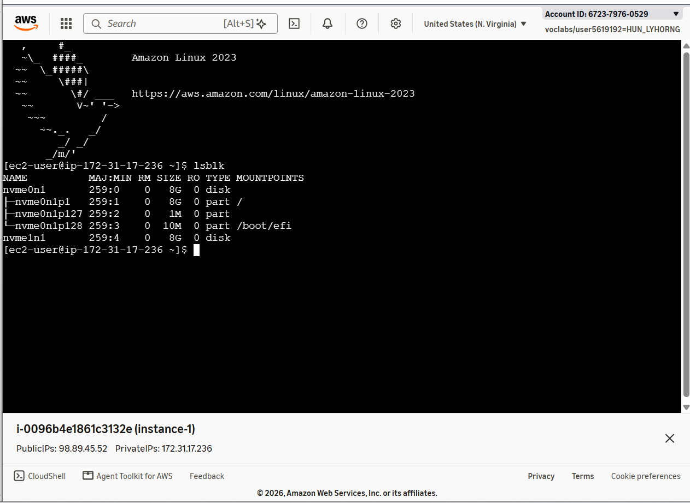
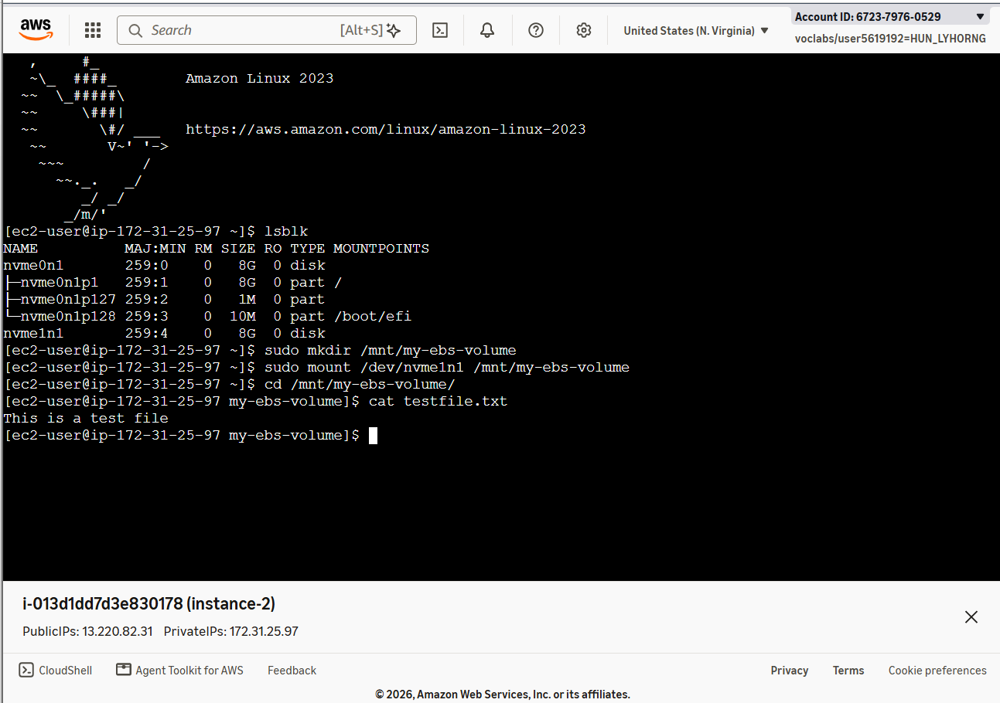
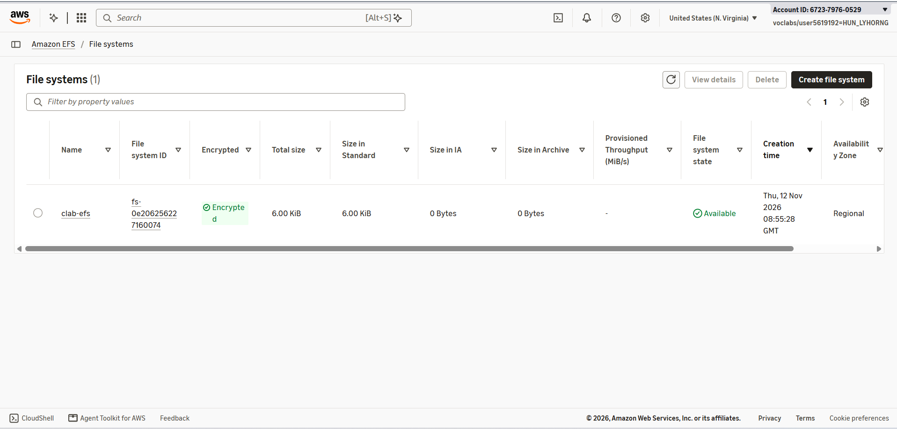
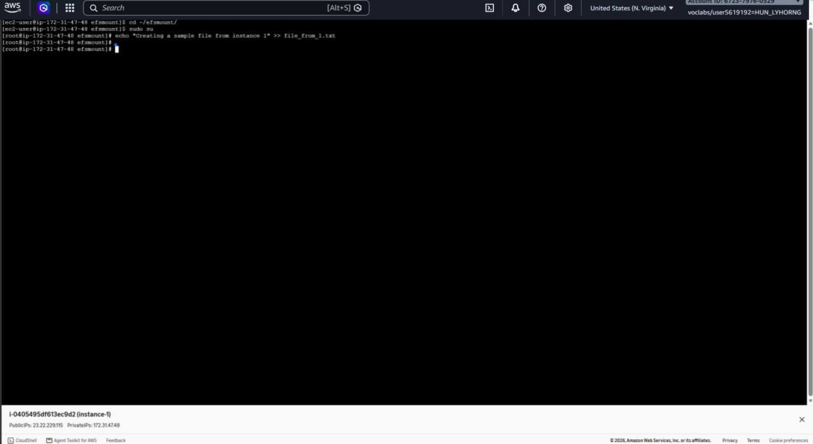
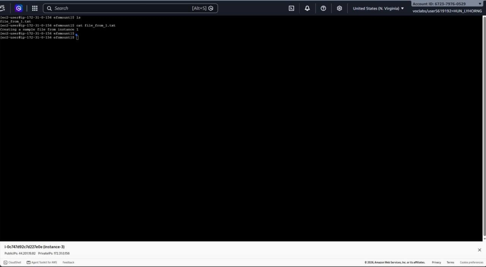

# Cloud Lab 3 Submission — AWS Storage Options

- **Student name:** Hun Lyhorng
- **Student ID:** e20220188
- **Learner Lab user name:** HUN_LYHORNG
- **Date completed:** 12/11/2026

---

## Part 2.1 — Amazon S3

### Bucket list

### Uploaded files

### Static website

---

## Part 2.2 — Amazon EBS

### Volumes page

### Attached volume (`lsblk`)

Which device name did your volume get (`xvdf`, `nvme1n1`, ...)?

### File read on instance-2

---

## Part 2.3 — Amazon EFS

### File system and mount targets

### File created on instance-1

### File listed on instance-3

---

## Questions

#### 1. Why did the static website endpoint first answer 403 Forbidden?

The bucket was not publicly accessible, so visitors could not read its objects. After adding the bucket policy with `s3:GetObject` permission for everyone (`Principal: *`), visitors could access the website files.

#### 2. What would happen to a file saved on instance-1's root volume after terminating instance-1?

The file would be deleted because the root volume is configured to be deleted when its EC2 instance is terminated. Unlike the additional Backup Volume, it does not persist independently by default.

#### 3. Why did you run `mkfs` on instance-1 but not on instance-2?

We ran `mkfs` on instance-1 to create an ext4 file system on the new, unformatted EBS volume. We did not run it again on instance-2 because the volume already contained a file system and data. Running `mkfs` again would erase the existing data.

#### 4. Why could instance-1 and instance-3 use EFS at the same time, and why did they need to be in the subnets of the mount targets?

EFS is a shared network file system that allows multiple EC2 instances to access the same files simultaneously using NFS. EBS is block storage that can only be attached to one instance at a time. The instances needed to be in the subnets of the mount targets so they could connect to EFS through the appropriate network endpoints.

#### 5. Choose S3, EBS or EFS for each need and give one reason.

| Need                                       | Storage | Reason                                                           |
| ------------------------------------------ | ------- | ---------------------------------------------------------------- |
| (a) A website's images                     | **S3**  | Stores and serves images as objects and scales easily.           |
| (b) The disk of a database server          | **EBS** | Provides block storage that can be attached to an EC2 instance.  |
| (c) A folder shared by several web servers | **EFS** | Allows multiple servers to access the same files simultaneously. |