# Cloud Lab 4 Submission — Amazon VPC

- **Student name:** Hun Lyhorng
- **Student ID:** e20220188
- **Learner Lab user name:** HUN_LYHORNG
- **Date completed:** 05/11/2026

---

## VPC and internet gateway

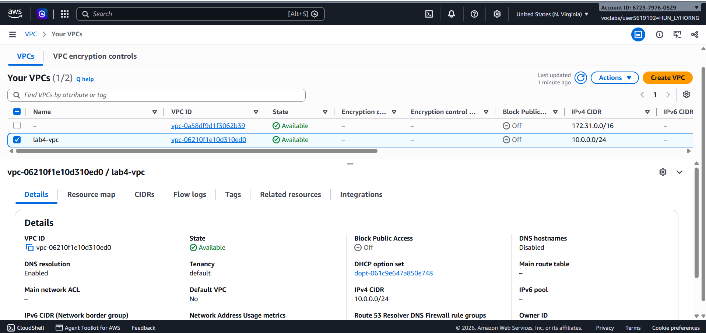

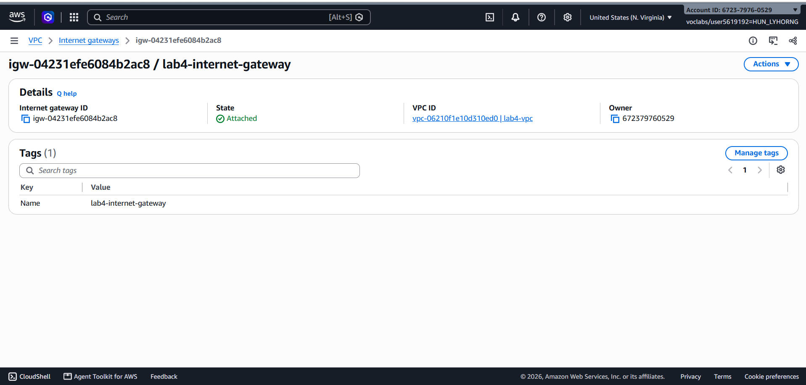

## Public subnet

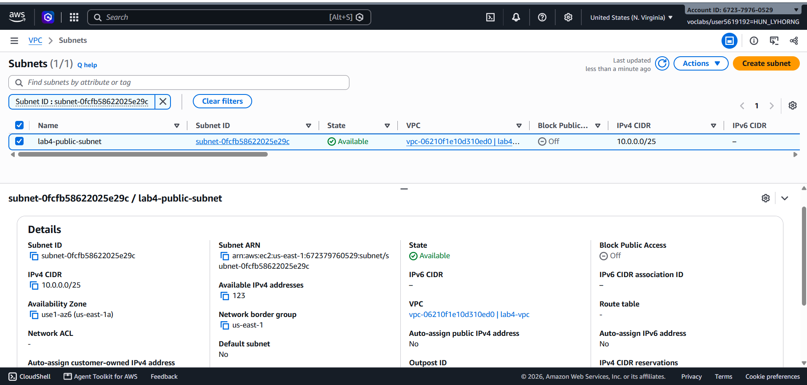

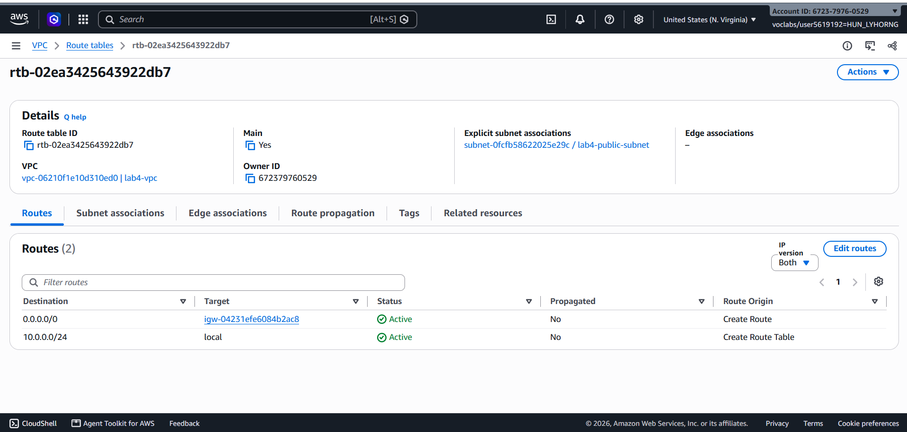

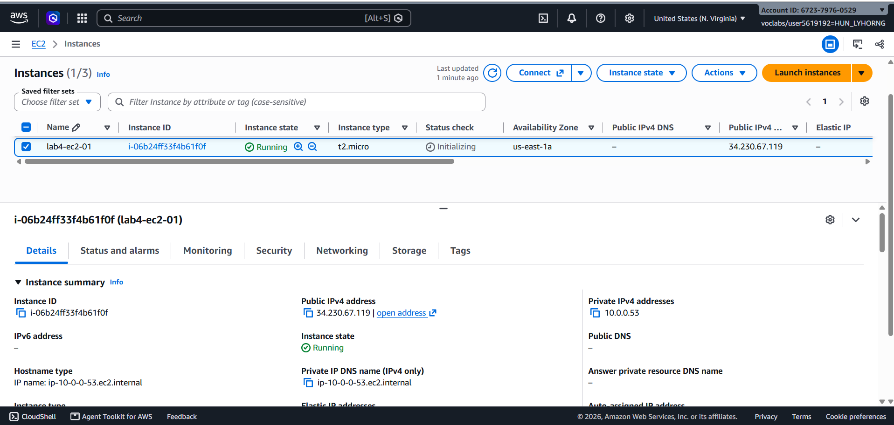

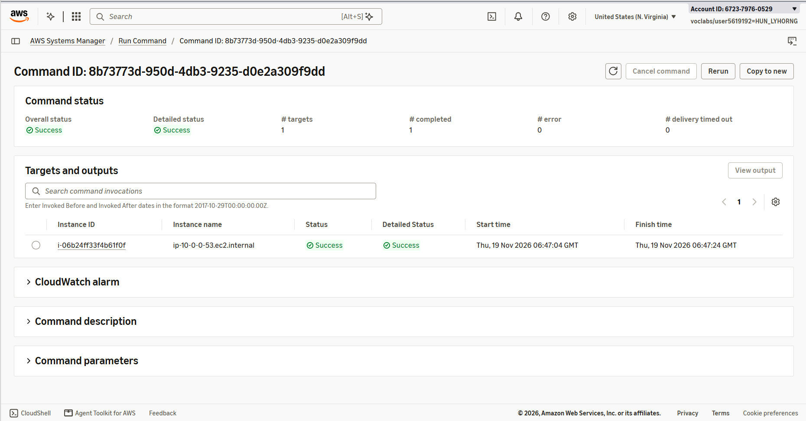

## Private subnet

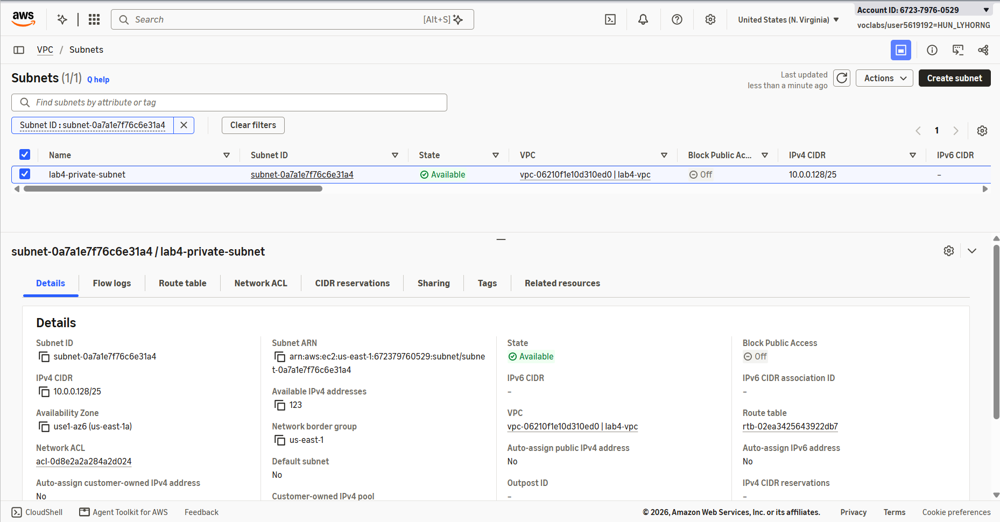

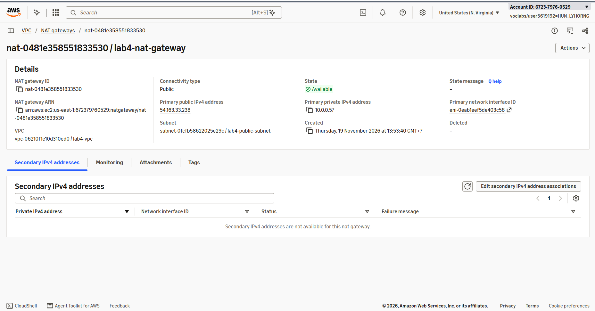

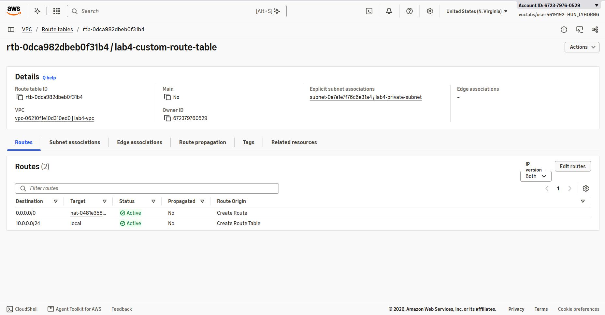

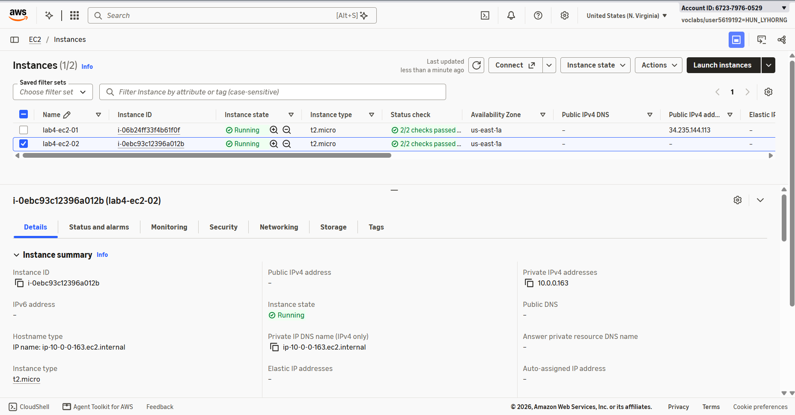

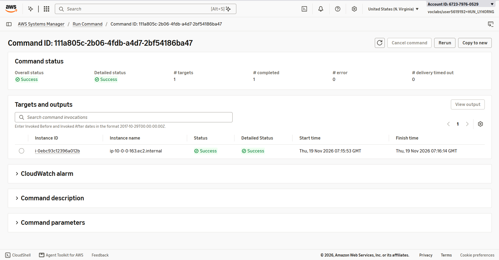

---

## Questions

**1. The VPC is `10.0.0.0/24` and the subnets are `10.0.0.0/25` and `10.0.0.128/25`. How many IP addresses does each block contain, and why do the two subnets not overlap?**

Each `/25` subnet contains 128 IP addresses. The two subnets do not overlap because they cover different IP ranges: `10.0.0.0–10.0.0.127` and `10.0.0.128–10.0.0.255`.

**2. Both subnets are in the same VPC. What exactly makes `lab4-public-subnet` public and `lab4-private-subnet` private?**

The public subnet has a route to the Internet Gateway (`0.0.0.0/0`), allowing internet communication. The private subnet routes outbound internet traffic through a NAT Gateway instead, without allowing direct inbound internet connections.

**3. Why is the NAT gateway placed in the public subnet and not in the private one?**

The NAT Gateway needs access to the Internet Gateway to communicate with the internet. Therefore, it must be placed in a public subnet with a public IP address.

**4. `lab4-ec2-02` has no public IP address. Can someone on the internet open a connection to it? Can it download updates? Explain both answers.**

No, someone on the internet cannot directly connect to the instance because it has no public IP address. However, it can download updates through the NAT Gateway, which allows outbound internet connections without exposing the instance to incoming connections.

**5. You tested internet access with Systems Manager instead of SSH. Why did the instances need `LabInstanceProfile` for this?**

The `LabInstanceProfile` provides the EC2 instances with an IAM role that grants permission to communicate with AWS Systems Manager. This allows us to manage and access the instances through Session Manager without needing SSH or opening port 22.

## Clean up

- [x] Instances terminated.
- [x] NAT gateway deleted and its Elastic IP released.
- [x] Internet gateway detached and deleted.
- [x] `lab4-vpc` deleted.